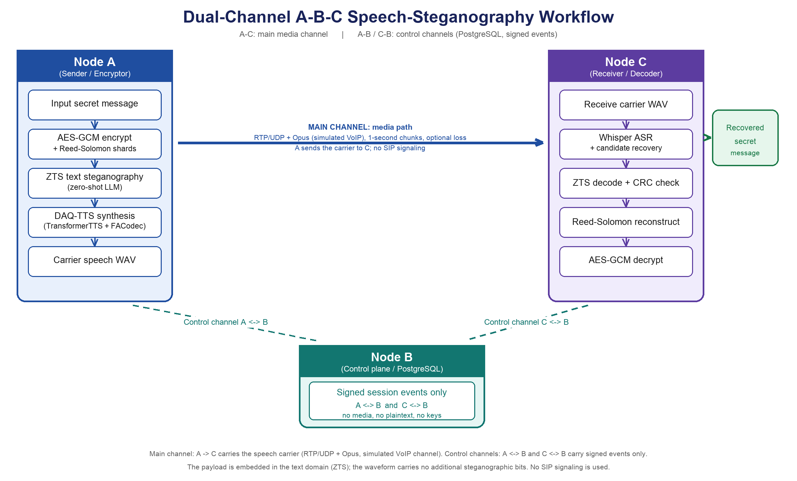

# STSC Research Artifact



STSC is a generative **text-steganography system with synthesized-speech
transport**. Secret bits affect token selection during text generation; the
resulting text is synthesized, transported as speech, transcribed by ASR, and
decoded at the linguistic layer. No secret bits are inserted directly into WAV
samples or codec parameters.

This repository is the reviewer-facing integration package for the IEEE IoT
Journal revision. It exposes the main-path code, the frozen protocol sources and
a small stable package/CLI; model weights and datasets are not shipped.

## Repository layout

| Folder | Role |
|---|---|
| `A/` | Sender node: AES-GCM + Reed-Solomon, ZTS text steganography, DAQ-TTS synthesis, dual-channel coordination, receiver-side decoding, control-channel client |
| `B/` | Relay / receiver node: RTP/UDP--Opus media sender and impairment relay, control-plane (PostgreSQL) client, and receiver utilities |
| `C/` | Second sender/receiver package: byte-identical to `A/` (generated from the same template); only the packaged prompt/corpus reference differs |

Each folder is a self-contained Python package with its own `README.md`,
`pyproject.toml`, `tools/`, `configs/`, `tests/` and, for A/C, the
`legacy/` sources of the integrated components.

## What has been validated

The following paths have completed real experiments on the authors' testbed:

1. **Secure IMDB speech-transport batch**
   - AES-256-GCM authenticated encryption;
   - Reed-Solomon erasure recovery;
   - 30 authenticated 40-bit ZTS shard frames;
   - TransformerTTS LJSpeech step-90000 synthesis;
   - Whisper small.en ASR;
   - payload-independent candidate generation and isolated fragment receiver;
   - 24/30 shards recovered from 137 carriers;
   - RS reconstruction, AES-GCM authentication, and exact plaintext match.

2. **Two-host RTP/Opus media path**
   - node B sends Opus in RTP/UDP to node A over Tailscale;
   - node A records 16-kHz PCM WAV;
   - pre-network and post-network Whisper transcripts matched in the smoke run;
   - downstream ZTS fragment decoding completed successfully.

3. **Bidirectional authenticated control path**
   - PostgreSQL 17 on node B, restricted to localhost and the B Tailscale IP;
   - SCRAM-SHA-256 database authentication;
   - canonical JSON events authenticated with per-session/per-actor
     HKDF-HMAC-SHA-256 keys;
   - event expiry, replay protection, and fail-closed tamper checks;
   - A->B `SESSION_OPENED` and B->A signed acknowledgement independently verified.

The validated network experiment uses **RTP/UDP + Opus**, not SIP signaling.
The code and paper must not describe it as a SIP call.

## Start here

```text
README.md                         Project scope and verified claims (this file)
A/, B/, C/                        The three node packages (see each README.md)
A/REVIEWER_GUIDE.md               Minimal reproduction commands
A/configs/                        Frozen experiment profiles
A/zsc_tsd/                        Stable integration package
A/tools/                          Main-path scripts (batch runner, fragment protocol,
                                  receiver, ASR worker, TTS/FACodec/NISQA helpers)
A/legacy/                         Sources of the integrated components
                                  (zero-shot-GLS, TransformerTTS, FACodec, NISQA)
A/requirements/                   Per-environment dependency lists
C/external_tools-zgls/            (see C/) compatibility layer for the ZTS sources
C/tests/, A/tests/                CPU tests plus optional model tests
A/01_create_conda_envs.ps1        One-click environment creation
A/02_download_models.ps1          One-click model download
A/03_configure_network.ps1        One-click A/B network and PostgreSQL setup
A/04_run_full_experiment.ps1      One-click end-to-end run
A/reviewer.ps1                    One-command setup, verification, and runs
```

For a new reviewer machine, begin inside the package of that machine:

```powershell
cd A
.\reviewer.ps1 -Action PlanA
.\reviewer.ps1 -Action SetupA -AcceptModelLicenses
.\reviewer.ps1 -Action QuickTestA
```

Node B uses `PlanB`, `SetupB`, and `QuickTestB` from `B/reviewer.ps1`.
See `A/docs/ONE_CLICK_REPRODUCTION.md` for the frozen model lock, mirror
selection, secure batch action, and the physical-node actions.

Only main-path scripts are kept under `tools/`; historical development copies
were removed to keep the artifact clean. New code should import `zsc_tsd` or
call `python -m zsc_tsd`; it should not import an experimental script directly.

## Stable package map (A/C)

```text
zsc_tsd/
  cli.py                 one reviewer-facing CLI
  config.py              YAML profile inheritance and validation
  manifest.py            SHA-256 provenance manifests
  report.py              consistent public/private/receiver run layout
  control/               PostgreSQL + HKDF-HMAC authenticated events
  crypto/                AES-256-GCM, keys, CRC framing
  dual_channel/          A coordinator, B relay, provisioning, evidence
  pipeline/              sender, receiver, local integration facades
  speech/                TransformerTTS, Whisper, normalization, metrics
  transport/             local adapter and RTP/Opus command construction
  zts/                   verified ZTS encoder, decoder, adapter, manifest
```

## Environment design

Incompatible heavy dependencies are intentionally separated:

| Environment | Responsibility |
|---|---|
| `zsc-tsd-zts` | ZTS model, orchestration, candidate receiver |
| `zsc-tsd-tts` | TensorFlow TransformerTTS synthesis |
| `zsc-tsd-asr` | Whisper ASR |
| `zsc-tsd-facodec` | FACodec voice conversion (DAQ-TTS back end) |
| evaluation environment | NISQA and text-steganalysis experiments |
| B control venv | PostgreSQL/HMAC verification only |

The paper uses **DAQ-TTS** as the name of the combined speech-generation
architecture. The reproduced end-to-end path in this artifact records its
actual backend precisely: public TransformerTTS LJSpeech step-90000. This
avoids presenting the public checkpoint as a newly trained model.

## Not bundled

Model checkpoints and datasets are **not** shipped. Code and configs for each
component are included. Set the following up by yourself before running the
full pipeline:

| Component | Missing asset | Provided tool |
|---|---|---|
| ZTS | Llama-2-7B GPTQ checkpoint | `tools/download_models.py` |
| ZTS prompts | IMDb sentence CSV (`sentence_id,plaintext`) | `tools/collect_d3_dataset.py` |
| TransformerTTS | LJSpeech step-90000 `config.yaml` + `model_weights.hdf5` | `tools/setup_daqtts_reviewer.py` |
| FACodec | `ns3_facodec_encoder_v2.bin`, `ns3_facodec_decoder_v2.bin` | `tools/setup_daqtts_reviewer.py` |
| ASR | Whisper small.en | `tools/download_models.py` |
| NISQA | NISQA weights | download from the NISQA release |

Tests that require these assets skip automatically, so `python -m pytest -q`
passes on a clean checkout.

## Lightweight installation

Python 3.10 is the frozen orchestration version.

```powershell
cd A
py -3.10 -m venv .venv
.\.venv\Scripts\Activate.ps1
python -m pip install --upgrade pip
python -m pip install -e ".[dev,control]"
```

Copy `.env.example` to `.env` only for local use. Do not commit PostgreSQL
passwords, AES keys, control master keys, model weights, or private sender
reports.

## Basic verification

```powershell
cd A
python -m zsc_tsd preflight --profile paper_r1
python -m zsc_tsd show-config voip
python -m pytest -q
```

CPU tests cover AES-GCM authentication, CRC framing, configuration resolution,
local-transport labeling, RTP/Opus plans, and HMAC tamper/expiry handling.
Model tests skip when frozen model files or CUDA are unavailable.

## Reproduce the secure IMDB batch

The stable CLI delegates to the frozen v1.4 implementation without changing
receiver rules. Provide your own secure bundle (public/private commitment
files); the bundle is produced by the sender-side tooling and is not shipped:

```powershell
python -m zsc_tsd secure-imdb-batch `
  --bundle-public <path-to-bundle>\public_commitment.json `
  --bundle-private <path-to-bundle>\sender_private.json
```

Expected final evidence is written below a new timestamped directory as
`public\final_result_after_reveal.json`. Existing evidence is never
overwritten.

## Build a two-host RTP/Opus plan

```powershell
python -m zsc_tsd rtp-plan `
  --ffmpeg <path-to-ffmpeg.exe> `
  --source-wav <path-to-carrier.wav> `
  --receiver-ip <A-tailscale-ip> `
  --receiver-sdp <path-to-receiver.sdp> `
  --received-wav <path-to-received.wav>
```

This prints separate sender and receiver commands and an SDP description. It
does not pretend to launch both physical hosts from one process.

## Run the authenticated two-host experiment

This workflow uses one command per physical node. Node A prints a new
`session_id` and `correlation_id`; those identifiers are then supplied to the
single relay command on B.

Before the first run, apply the idempotent schema migration on A or B:

```powershell
python tools\zts_control_channel_cli.py init-db `
  --schema zsc_tsd\control\schema.sql
```

Start node A first:

```powershell
python -m zsc_tsd dual-channel-run `
  --source-wav <carrier.wav> `
  --ffmpeg <path-to-ffmpeg.exe> `
  --a-ip <A-tailscale-ip> `
  --b-ip <B-tailscale-ip>
```

Then start node B with the identifiers printed by A:

```powershell
python -m zsc_tsd dual-channel-relay `
  --session-id <SESSION_ID_FROM_A> `
  --correlation-id <CORRELATION_ID_FROM_A> `
  --ffmpeg <path-to-ffmpeg.exe> `
  --expected-a-ip <A-tailscale-ip> `
  --b-ip <B-tailscale-ip>
```

The A-to-B HTTP fetch is a restricted, hash-committed **experiment carrier
provisioning step**. It is not counted or reported as VoIP. The measured media
path is the subsequent B-to-A RTP/UDP Opus transmission. PostgreSQL contains
only signed metadata.

Without `--decoder-command-json`, a successful run ends with
`ZSC_TSD_DUAL_CHANNEL_MEDIA_PASS`. It is intentionally impossible for that
run to claim exact message recovery. `ZSC_TSD_DUAL_CHANNEL_END_TO_END_PASS`
requires a decoder report in which receiver decoding, Reed-Solomon recovery,
AES-GCM authentication, and exact plaintext matching are all true.

## Control channel

See `A/docs/CONTROL_CHANNEL_V1.md`. The database carries authenticated metadata
only. Secret plaintext, AES keys, ciphertext, RS bytes, hidden fragment bytes,
stegotext, token IDs, and reference transcripts are prohibited from control
events.

## Artifact policy

- `zsc_tsd/` is the maintained interface.
- `tools/` contains only the main-path scripts (batch runner, fragment protocol,
  candidate frontends, ASR/TTS/FACodec helpers, metrics).
- Every new run uses a new output directory and records SHA-256 hashes.
- Local file copying is labeled as local integration, never VoIP.
- RTP/Opus transport is labeled accurately; SIP is not claimed.
- Retries, erasures, candidate-space truncation, and failed carriers remain in
  reports and are not removed from denominators.
